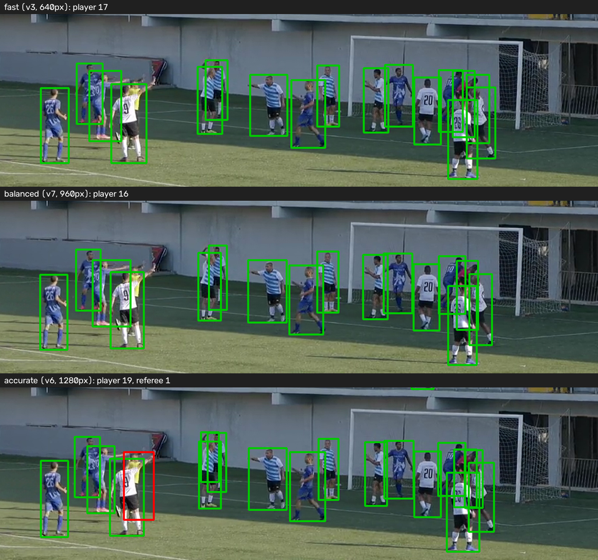
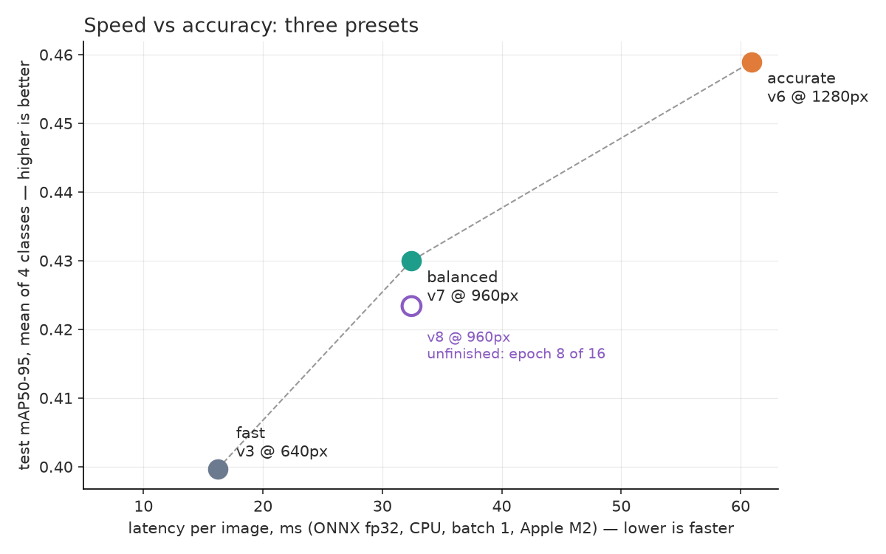
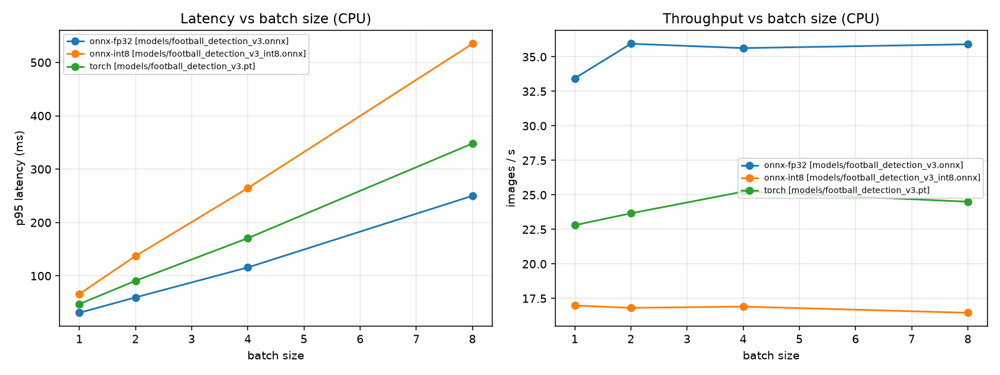
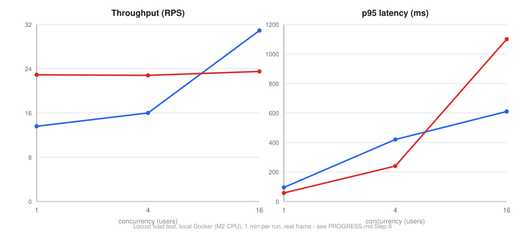

# football-detect-serve

[](https://github.com/Kushagra077/football-detect-serve/actions/workflows/tests.yml)

Football object detection (ball / goalkeeper / player / referee, plus a minor `other`
class) — YOLO26 trained
on broadcast football footage, exported to ONNX, quantized to INT8, and served behind a
batching FastAPI service with a live demo on Hugging Face Spaces.

**[Live demo](https://huggingface.co/spaces/Kushagra77/football-detect-serve)** (Gradio,
ZeroGPU — see the [Live demo](#live-demo) section below for why its numbers won't match
the table below)

The point of the repo is the path from checkpoint to endpoint: every optimization step has
a gate, every backend is measured through the same code, and every number below came from
running that code, not from a spec sheet.



*One frame from a free-licence amateur match clip (Pexels, not from the training data), cropped, run through the three presets. The accurate preset (bottom) is the only one that boxes the person in the yellow shirt, presumably the referee (red box). One frame with no ground truth: an illustration, not a metric.*

### 20-second demo

[](demo/brag.mp4)

*Click for the full video with sound ([demo/brag.mp4](demo/brag.mp4)). It's the acceptance sentence below, minus the paragraphs.*

## Results

### Model presets: speed vs accuracy

One service, three trade-off points. A faster model costs accuracy; a more accurate one costs
time. The server loads all three, and `?backend=fast|balanced|accurate` picks one per request.



| preset | model | input size | test mAP50-95 | val mAP50-95 | ball AP (test) | latency, batch 1 (p50 / p95) | throughput, batch 8 |
|---|---|---|---|---|---|---|---|
| **fast** | v3 | 640 | 0.400 | 0.470 | 0.111 | 16.2 / 17.1 ms | 66 img/s |
| **balanced** | v7 | 960 | 0.430 | 0.497 | 0.140 | 32.4 / 35.2 ms | 31 img/s |
| **accurate** | v6 | 1280 | 0.459 | 0.529 | 0.178 | 60.9 / 62.6 ms | 17 img/s |

mAP is the 4-class mean (ball / goalkeeper / player / referee) from `scripts/eval_map.py`, the same
evaluator for every model. Latency is ONNX fp32 on CPU (Apple M2, 4 threads, 100 runs after 20 warm-up),
measured by `scripts/benchmark.py` with each model at its own input size (`reports/latency.presets.json`).

- **Each step up costs about twice the time and buys about +0.03 test mAP.** The ball gains the most
  (0.111 to 0.178, +60%) but stays the weakest class at every size.
- **Same network, different input size.** All three are YOLO26 nano (a 10 MB ONNX file each). v6 and v7 were
  trained at 1280 and 960; v3 at 640.
- **Which to use.** *fast* for real-time video on a CPU (25 fps needs about 25 img/s per stream: fast and
  balanced clear it on this machine, accurate does not). *accurate* for offline analysis, such as reviewing a
  match after it has been played. *balanced* is the default.
- **In Docker** (a Linux VM on the same M2; the whole request, including decoding a 1080p JPEG), the median
  request takes 42 / 60 / 103 ms for fast / balanced / accurate, and the container holds all three models in
  about 1 GiB of RAM.
- **Batch size 2 is slower per image than batch 1 or 4** for all three models (cause not investigated); read
  throughput from batch 4 or 8.
- **v8** repeated v7 with settings from a short hyperparameter search. It was cancelled by a 12-hour session
  limit at epoch 10 of 16, and its best checkpoint (epoch 8) scored 0.423 test / 0.503 val, no better than
  v7, so it is reported in the tables but not served.

### Accuracy

Two evaluations, because the two splits don't mean the same thing:

- **`test`** — 3 matches that appear **nowhere** in training (different stadiums, teams,
  kits, camera setups). This is the trustworthy generalization number.
- **`val`** — carved out of the training pool (every 5th sequence), which only contains
  3 matches total. So val shares stadiums/kits/cameras with training and reads
  **optimistically**. Kept for training-time monitoring, not as a headline result.

Model lineage: **v1 nano** and **v2 small** are 10-epoch baselines. **v3 nano** is the
current nano — 20 epochs, with `mixup=0.1` added specifically to help the rare, tiny ball
class. (`copy_paste` is not used: it requires per-instance segmentation masks, and this is
a bbox-only detection dataset — with no masks it silently no-ops in ultralytics, so it's
left off rather than set and ignored.) v3 replaces v1; v1's numbers are kept as the
before/after reference.

Later runs changed the input size, which turned out to be the biggest lever: **v6** trained at 1280 (30 planned epochs, stopped at epoch 25 by a session limit; the epoch-15 checkpoint, the best on validation, is the one evaluated and served), **v7** at 960 (20 epochs, `scale` 0.5, `mixup` 0, `close_mosaic` 5), and **v8** repeated v7 with tuned settings and is unfinished (see [Model presets](#model-presets-speed-vs-accuracy)).

#### test split — mAP50-95, torch, 36,750 images (the real number)

| model | all\* | ball | goalkeeper | player | referee | other† |
|---|---|---|---|---|---|---|
| v1 nano (10ep baseline) | 0.369 | 0.090 | 0.377 | 0.571 | 0.435 | 0.245 |
| **v3 nano** | 0.400 | **0.111** | 0.435 | 0.594 | 0.459 | 0.225 |
| **v2 small** | 0.431 | 0.131 | 0.484 | 0.618 | 0.492 | 0.231 |
| **v7 nano, 960px** | 0.430 | 0.140 | 0.457 | 0.629 | 0.494 | 0.371 |
| v8 nano, 960px (unfinished, epoch 8 of 16) | 0.423 | 0.141 | 0.438 | 0.624 | 0.491 | 0.258 |
| **v6 nano, 1280px** | 0.459 | 0.178 | 0.506 | 0.645 | 0.507 | 0.378 |

\* 4-class mean (ball/goalkeeper/player/referee) — the headline number. † `other` is a
minor class, not included in `all`: it's SoccerNet-derived catch-all (sideline staff,
etc.), thinly validated (0 instances in val, 1,313 in test), and over-predicted at
~0.23-0.25 AP — kept in the model for completeness, not as a class the headline number
should ride on.

**v1 → v3**: ball AP **+23%** on this trustworthy split (0.090 → 0.111), every other real
class up too — the extra epochs and `mixup` combined to help. (Two things changed at once —
10→20 epochs *and* `mixup` — so the gain can't be cleanly attributed to either alone.)

#### val split — mAP50-95, 8,250 images (training-time monitoring only)

| model | backend | all\* | ball | goalkeeper | player | referee |
|---|---|---|---|---|---|---|
| off-the-shelf COCO yolo26n (remapped) | torch | 0.093 | 0.013 | 0.000 | 0.361 | 0.000 |
| v1 nano (10ep baseline) | torch | 0.427 | 0.069 | 0.475 | 0.603 | 0.560 |
| **v3 nano** | torch | 0.470 | 0.094 | 0.564 | 0.629 | 0.591 |
| **v3 nano** | onnx-fp32 | 0.470 | 0.094 | 0.564 | 0.629 | 0.591 |
| **v3 nano** | onnx-int8 | 0.436 (−0.033) | 0.080 | 0.527 | 0.587 | 0.552 |
| **v2 small** | torch | 0.487 | 0.129 | 0.575 | 0.639 | 0.605 |
| v2 small | onnx-fp32 | 0.487 | 0.129 | 0.575 | 0.639 | 0.605 |
| v2 small | onnx-int8 | 0.423 (−0.064) | 0.069 | 0.497 | 0.577 | 0.549 |
| **v7 nano, 960px** | torch | 0.497 | 0.146 | 0.573 | 0.652 | 0.615 |
| v8 nano, 960px (unfinished) | torch | 0.503 | 0.139 | 0.605 | 0.654 | 0.615 |
| **v6 nano, 1280px** | torch | 0.529 | 0.185 | 0.642 | 0.662 | 0.625 |
| **v7 nano, 960px** | onnx-fp32 | 0.497 | 0.146 | 0.573 | 0.652 | 0.615 |
| **v6 nano, 1280px** | onnx-fp32 | 0.529 | 0.185 | 0.642 | 0.662 | 0.625 |
| **v6 nano, 1280px** | onnx-int8 | 0.483 (−0.046) | 0.135 | 0.577 | 0.623 | 0.598 |

\* 4-class mean — `other` has 0 instances in val, so it's excluded. ONNX/INT8 rows are
val-only: they measure export fidelity and quantization cost, not generalization. The v7 and v6 fp32 ONNX
files match torch to three decimals in every class (the export gate). INT8 was measured for v6 only and costs
more than it did on v3 (−0.046), with no speed gain on this CPU, so the presets ship fp32.

#### val vs test: the gap is leakage, and its shape confirms it

Like-for-like (4-class mean, `other` excluded): v3 drops 0.470 → 0.400 (**−15%**),
v1 0.427 → 0.369 (−14%), v2 0.487 → 0.431 (−11%). The drop is concentrated in
**goalkeeper and referee** (−0.09 to −0.13 each) while **player barely moves**
(−0.02 to −0.03). That's the signature of match-level leakage, not random variance:
players look the same in any match, but a keeper's kit and a ref's uniform are
match-specific — memorizing them from training only helps on a val split that reuses
those matches. `ball` is dominated by noise at this training length.

- ONNX-fp32 reproduces torch to <0.001 mAP per class (val), across v1/v2/v3 — the export
  path is faithful.
- INT8 costs 0.03-0.06 mAP50-95 (val) — v1 −0.027, v2 −0.064, v3 −0.033. On v1 the ball
  class took the biggest relative hit (~42%); on v3 it's only ~15%, so the v3 ball
  detector (extra epochs + `mixup`) survives quantization noticeably better.
- v1/v2 are **10-epoch**, v3 is **20-epoch** — all still deliberately short of the
  100-epoch `configs/train.yaml` target. Every number here moves with a real training run.
- **Evaluator cross-check** (`scripts/crosscheck_map.py`): running ultralytics' own
  `YOLO.val()` on v3 lands ~0.015–0.02 mAP50-95 *lower* than `eval_map.py` on both val
  and test — a small, consistent optimistic bias, same direction on every populated class,
  no structural disagreement (`other`, the class most likely to expose an averaging bug,
  agrees to 0.005). The offset is almost certainly ultralytics' `rect=True` letterboxing
  vs the square resize the serving backends use. So the tables above read a touch high in
  absolute terms; every *relative* comparison in this section is unaffected.

### Latency (single-request, CPU, Apple M2 8-core, batch=1, v3 nano)

| backend | p50 ms | p95 ms | p99 ms | img/s |
|---|---|---|---|---|
| torch | 24.9 | 27.3 | 33.7 | 39.3 |
| onnx-fp32 | 16.3 | 18.7 | 20.2 | 60.1 |
| onnx-int8 | 19.0 | 21.0 | 23.0 | 51.9 |

(Within run-to-run noise of the earlier v1 numbers — latency tracks the architecture, not
the checkpoint, and v1/v3 are both yolo26n.)

**onnx-fp32 is 1.5x torch, free** — no accuracy cost (see table above), just a different
runtime. **onnx-int8 is *slower* than fp32 on this hardware** — Apple Silicon (ARM) lacks
the x86-VNNI instructions onnxruntime's INT8 kernels are tuned for, so it's paying dequant
overhead for no speed gain. FP16 was measured and dropped from this table: on CPU it ties
fp32 on accuracy and is *slower* (onnxruntime has no native fp16 kernels on CPU, so it
upcasts and pays the cast cost) — FP16 only helps on GPU, and this service targets CPU.

### Latency (single-request, CPU, x86_64, 2 physical cores, batch=1, v3 nano)

Measured on GitHub Actions' `ubuntu-latest` runner
(`.github/workflows/benchmark.yml`), confirming or denying the ARM-kernel-tuning
hypothesis above instead of leaving it hedged (`reports/latency.x86.json`):



| backend | p50 ms | p95 ms | p99 ms | img/s |
|---|---|---|---|---|
| torch | 43.7 | 47.2 | 47.9 | 22.8 |
| onnx-fp32 | 29.8 | 30.8 | 31.3 | 33.4 |
| onnx-int8 | 57.7 | 66.0 | 69.4 | 17.0 |

**The hypothesis was wrong.** onnx-int8 is *slower* than fp32 on x86 too (1.9x, worse
than the 1.2x gap on ARM) — not an ARM-specific kernel-tuning artifact, a property of
this model/runtime pairing on CPU generally. The 2-physical-core runner also makes every
backend slower in absolute terms than the 8-core M2, so absolute numbers aren't
comparable across the two tables — only the fp32-vs-int8 *ordering* is the point of
this run, and it agrees with the M2 result.

### Load test: does batching help? (Locust, local Docker, `onnx-fp32`, 1 min/run)



| concurrency | batching | RPS | p50 ms | p95 ms | p99 ms |
|---|---|---|---|---|---|
| 1 | on | 12.6 | 73 | 120 | 180 |
| 1 | off | 19.1 | 50 | 68 | 85 |
| 4 | on | 16.3 | 260 | 370 | 520 |
| 4 | off | 20.3 | 190 | 260 | 340 |
| 16 | on | 28.2 | 540 | 670 | 1100 |
| 16 | off | 21.1 | 750 | 1200 | 1400 |

Re-measured after fixing a real bug these numbers exposed: `?batch=false` requests were
calling `backend.predict()` straight from the executor thread pool with no synchronization,
so concurrent nobatch requests could run on the same underlying model object at once —
ultralytics' `YOLO` isn't thread-safe, so that's silent data-corrupting territory, not just
a performance question. Fixed with a `predict_lock` per backend
(`app/backends/base.py`), held by both the nobatch path and the batch worker. The batched
arm barely moved (it was already single-threaded), but nobatch dropped 10-17% on RPS
against the old, racier numbers, and its concurrency-16 tail latency got markedly worse
(max response time 9.1s vs the old 3.5s) — the honest cost of requests now genuinely
queuing for the lock instead of unsafely overlapping.

**The answer is still "it depends on load," not a flat yes/no.** At concurrency 1 and 4,
batching is pure overhead — most requests never find a batch partner inside the 15ms
`MAX_WAIT_MS` window, so they pay that wait and then run solo anyway (nobatch wins on
every axis). At concurrency 16, batching wins outright — higher throughput (28.2 vs 21.1
RPS) *and* lower latency at every percentile — because enough concurrent requests land
inside the window to be grouped into one forward pass, which beats 16 single-image calls
serializing behind the same lock. Zero request failures across all six runs.

### The acceptance sentence

> The ONNX runtime gave **1.5x** for free; INT8 bought **nothing** on CPU — ARM or x86 —
> and cost 0.03-0.06 mAP50-95 — the honest result of measuring rather than assuming.

## Design rules

1. **One inference path per backend, no custom decode.** `app/backends/torch_backend.py`
   and `onnx_backend.py` both call ultralytics' own `YOLO(...).predict()`, which knows how
   to decode YOLO26's end-to-end (NMS-free, top-k) head — a hand-rolled decoder assuming
   the classic dense anchor-grid output silently produced garbage on this architecture
   (see git history / old PROGRESS.md entries if curious). `app/backends/base.py` now
   holds only the shared `Detection`/`to_detections()` contract both backends convert
   ultralytics' output through — no manual letterbox/decode step exists in this repo.
2. **One evaluator for every backend.** `scripts/eval_map.py` computes COCO-style AP
   itself for torch and ONNX alike through the shared `DetectorBackend.predict()`
   interface, so comparing backends never means comparing two different measurement
   methods. It's cross-checked against ultralytics' own `YOLO.val()` via
   `scripts/crosscheck_map.py` — they agree to ~0.02 mAP50-95 (see Accuracy).
3. **Parity via the same evaluator, not a separate raw-tensor diff.** ONNX-vs-torch
   fidelity is checked by running `eval_map.py` on both and comparing per-class mAP to
   3 decimal places, not by diffing raw model output tensors (which YOLO26's end-to-end
   head format makes brittle across backends).
4. **Quantize against real data - deliberately sampled, not just sliced.** `--quantize 8`
   calibrates INT8 on 345 real training images run through the real preprocessing path,
   picked by `scripts/build_calibration_set.py` to spread evenly across all 46 training
   sequences. That script exists because the naive version (`--split train --fraction
   0.01`) doesn't randomly sample anything: ultralytics sorts the file list alphabetically
   before slicing a fraction, and with `<sequence>_<frame>.jpg` filenames that's the first
   ~345 frames of whichever sequence sorts first - one ~14-second clip, one stadium, one
   lighting condition. Either way the result is a measured mAP drop, not an assumption -
   but only the stratified sample is a calibration set that means anything.

## Layout

```
configs/train.yaml           epochs, imgsz, batch, augmentation, expected class map
scripts/prepare_data.py      verify class map, count instances, flag bad labels
scripts/convert_mot_to_yolo.py   MOT gt.txt + gameinfo.ini -> YOLO format
scripts/train.py              thin wrapper over ultralytics
scripts/build_calibration_set.py  shuffled, cross-sequence image list for INT8 calibration
scripts/export_onnx.py        pt -> onnx, fp32/fp16/int8, static INT8 calibration
scripts/eval_map.py           per-class mAP for ANY backend, one code path
scripts/crosscheck_map.py     eval_map.py vs ultralytics YOLO.val() - evaluator sanity check
scripts/benchmark.py          single-request latency harness -> reports/latency.json (each model at its own size)
scripts/plot_presets.py       speed/accuracy, per-class and training-curve charts, from the report files
scripts/render_presets.py     one frame through the three presets, side by side
app/main.py                   FastAPI: /predict /healthz /metrics, multi-backend registry
app/batching.py                asyncio queue + max-wait window
app/backends/                  base (contract) + torch + onnx (fp32/fp16/int8)
app/gradio_app.py              HF Space demo - calls build_backend() directly, no FastAPI
bench/locustfile.py            load test: concurrency x batching on/off
```

## Setup

```bash
python -m venv .venv && source .venv/bin/activate
pip install -r requirements.txt
```

The weights the three serving presets load (`models/football_detection_v3.onnx`, `_v7.onnx`, `_v6.onnx`, with a `.meta.json` beside each that records its input size) are included, so `docker build` and CI work from a clean clone. They are for non-commercial research use only (see [License](#license)). To reproduce them, run [Pipeline](#pipeline) below on your own [SoccerNet](https://www.soccer-net.org/data) access: the data, frames and labels are not distributed here, and `models/download_weights.py` has no default source to fetch from. The [Live demo](#live-demo) has the models loaded if you only want to see it work.

**Dataset license.** SoccerNet's annotations are released under **CC BY-NC 4.0**
(non-commercial). The broadcast videos themselves are separately gated behind an NDA —
downloading them requires submitting SoccerNet's NDA form, and redistributing the raw
video is prohibited by that agreement. Neither the videos nor the derived frames/labels
are distributed in this repo (the dataset dirs are gitignored) — you must obtain
your own SoccerNet access to reproduce the pipeline. See the
[SoccerNet FAQ](https://www.soccer-net.org/faq) for the full terms.

## Testing

```bash
pytest -v
```

`tests/` covers the pure logic — batching, metric math, label validation, the API's
error paths — through a fake `DetectorBackend` (`tests/conftest.py`). No real model
weights, ML deps (torch/ultralytics/onnxruntime), or dataset content are ever touched,
so the suite runs in about a second and needs nothing beyond what's already installed
for serving. Runs automatically on every push via GitHub Actions
(`.github/workflows/tests.yml`) — that's the badge at the top of this file.

## Pipeline

```bash
# 1. dataset: convert MOT tracking labels to YOLO format, then verify + count instances
python scripts/convert_mot_to_yolo.py --src <path-to-raw-mot-data>
python scripts/prepare_data.py --skip-download --out dataset

# 2. train (hyperparameters in configs/train.yaml)
# NOTE: the actual v1/v2/v3 checkpoints were trained via a raw model.train(...)
# call in a Kaggle notebook (multi-GPU), not through this script - configs/train.yaml
# documents the current (v3) recipe for reference, but editing it does not affect a
# Kaggle run. scripts/train.py + this command is the from-scratch reproduction path.
# configs/train.yaml targets 100 epochs; v3 is a 20-epoch run.
python scripts/train.py --weights yolo26n.pt --out models/football_detection_v3.pt --set epochs=20

# 3. accuracy (one code path for every backend). --split test is the trustworthy number,
#    --split val (default) is training-time monitoring only - see Results.
python scripts/eval_map.py --backend torch --weights models/football_detection_v3.pt --split test
# optional: sanity-check eval_map.py against ultralytics' own evaluator (~0.02 mAP agreement)
python scripts/crosscheck_map.py --weights models/football_detection_v3.pt --split test --device mps

# 4. export: fp32, fp16, int8. int8 calibrates on a curated, shuffled,
#    cross-sequence sample - NOT `--split train --fraction 0.01` directly,
#    which slices ultralytics' alphabetically-sorted file list and ends up as
#    the first ~345 frames of one clip (see build_calibration_set.py).
#    Run --quantize none LAST - the quantized exports reuse the base filename (see below).
python scripts/build_calibration_set.py
python scripts/export_onnx.py --weights models/football_detection_v3.pt --quantize 16
python scripts/export_onnx.py --weights models/football_detection_v3.pt --quantize 8 \
    --data dataset/calib_data.yaml --split train --fraction 1.0
python scripts/export_onnx.py --weights models/football_detection_v3.pt --quantize none

# 5. GATE — onnx-fp32 must match torch mAP to ~0.001/class; int8 drop must be sane, not collapsed
python scripts/eval_map.py --backend onnx --weights models/football_detection_v3.onnx
python scripts/eval_map.py --backend onnx --weights models/football_detection_v3_int8.onnx

# 6. single-request latency across backends and batch sizes
python scripts/benchmark.py
```

## Serving

```bash
MODELS="fast=models/football_detection_v3.onnx,balanced=models/football_detection_v7.onnx,accurate=models/football_detection_v6.onnx" \
DEFAULT_BACKEND=balanced uvicorn app.main:app --host 0.0.0.0 --port 7860
```

One process serves several models at once — `?backend=` picks one per request, so you can
demo and load-test the presets (or torch / onnx-fp32 / onnx-int8 of one model) side by side
without redeploying. **Each model runs at its own input size**: read from the `.meta.json` next to
the model, or set with a suffix (`MODELS="x=models/m.onnx@960"`). The backend type follows the file
(`.pt` is torch, anything else onnx), so names are free. `/healthz` lists the size of every loaded model.

| Env var | Default | Notes |
| --- | --- | --- |
| `MODELS` | `fast` (v3) + `balanced` (v7) + `accurate` (v6), ONNX fp32 | `name=path[@imgsz],name=path,...` |
| `DEFAULT_BACKEND` | first entry in `MODELS` (the Docker image sets `balanced`) | used when `?backend=` is omitted |
| `DEVICE` | `cpu` | |
| `IMGSZ` | `640` | fallback only, for a model with neither a sidecar nor an `@size` |
| `CONF` / `IOU` / `MAX_DET` | `0.25` / `0.45` / `300` | postprocess defaults, overridable per request |
| `MAX_BATCH_SIZE` | `8` | dynamic batch cap |
| `MAX_WAIT_MS` | `15` | how long a request waits to be batched |
| `MAX_QUEUE_SIZE` | `256` | overflow returns 503 rather than queueing forever |

### Endpoints

```bash
# multipart upload, pick a backend, bypass batching
curl -sS -F file=@frame.jpg "localhost:7860/predict?backend=accurate&batch=false" | jq

# json (base64 or url), with per-request thresholds
curl -sS localhost:7860/predict -H 'content-type: application/json' \
  -d '{"image_b64":"<...>","options":{"conf":0.4}}' | jq

curl -sS localhost:7860/healthz | jq   # lists every loaded backend and its input size
curl -sS localhost:7860/metrics | grep fds_   # per-backend counters/histograms
```

`/predict` returns boxes in original image coordinates plus `inference_ms`, `total_ms`,
`batch_size` and `batched` — the gap between `inference_ms` and `total_ms` is decode plus
(if `batched=true`) queue wait.

### Batching

One worker task per backend drains an asyncio queue and fires a forward pass as soon as
either `MAX_BATCH_SIZE` requests are ready or `MAX_WAIT_MS` has passed since the first one
arrived. `?batch=false` skips the queue entirely for a direct comparison. State is
per-process, so run `--workers 1` and scale with replicas, not worker count.

## Docker

**Local-only.** HF Docker Spaces are a paid tier, so this image is never deployed — it
exists to run the multi-backend service under the Locust load test and produce the
latency/throughput numbers above. The public demo is the separate [Gradio
app](#live-demo) instead.

```bash
docker build -t football-detect-serve:local .
docker run --rm -p 7860:7860 football-detect-serve:local
```

The image serves the three presets (fast / balanced / accurate) by default. Both backends
decode through ultralytics (see Design rules), so it includes torch + ultralytics, not just
onnxruntime: about 2.6 GB on disk. With all three presets loaded it used about 1 GiB of RAM
in testing, well inside a 3-4 GB container budget.

## Load test

```bash
locust -f bench/locustfile.py --headless -u 16 -r 16 -t 1m \
    --host http://localhost:7860 --html reports/loadtest/c16_batch.html

FDS_BATCH=false locust -f bench/locustfile.py --headless -u 16 -r 16 -t 1m \
    --host http://localhost:7860 --html reports/loadtest/c16_nobatch.html
```

Or drop `--headless` for the interactive web UI at `localhost:8089`. `FDS_IMAGE` /
`FDS_BACKEND` / `FDS_BATCH` env vars control the request; see `bench/locustfile.py` for
details. Six HTML reports (concurrency 1/4/16 x batching on/off) are in
`reports/loadtest/`.

## Live demo

The [HF Space](https://huggingface.co/spaces/Kushagra77/football-detect-serve) is a
Gradio app (`app/gradio_app.py`) that calls `build_backend()` directly — no FastAPI, no
batching queue, since it's a low-traffic demo, not the thing under load test.

HF's free tier only offers **ZeroGPU** hardware (not standalone CPU), so every backend in
the demo runs through one `@spaces.GPU`-wrapped call and *may* execute GPU-accelerated —
including the ONNX backends, since ZeroGPU makes `torch.cuda.is_available()` report `True`
everywhere in the process and ultralytics' ONNX backend touches raw CUDA internals
regardless of which execution provider you asked for. **This means the demo's relative
backend speed will not match the CPU latency table above** — that table is the real
comparison; the Space is for checking correctness and accuracy, not speed.

## Reports

| File | Written by |
| --- | --- |
| `reports/dataset.json` | `prepare_data.py` — per-class instance counts, label problems |
| `reports/accuracy.<backend>.<model>.json` | `eval_map.py` |
| `reports/latency.json`, `figures/latency.png` | `benchmark.py` (local, Apple M2) |
| `reports/latency.x86.json`, `figures/latency.x86.png` | `benchmark.py` (`benchmark.yml` CI run, x86) |
| `reports/latency.presets.json` | `benchmark.py` on the v3 / v7 / v6 ONNX presets (Apple M2) |
| `reports/training_curves.json` | validation mAP per epoch, copied out of the checkpoints |
| `figures/presets_*.png`, `figures/training_curves.png` | `plot_presets.py` |
| `figures/presets_example.png` | `render_presets.py` |
| `reports/loadtest/*.csv`, `*.html` | Locust |

## Limitations

- **Short training runs.** `configs/train.yaml` targets 100 epochs; v1/v2 are 10-epoch, v3 and v7
  are 20-epoch, v6 stopped at 25 of 30, v8 at 10 of 16. In the runs that went far enough, validation
  accuracy stopped improving after about 15 epochs (see `figures/training_curves.png`), so more
  epochs alone are unlikely to move the numbers much.
- **Single runs, no error bars.** Every number is one training run and one evaluation. Differences
  of about 0.01 mAP (for example v7 vs v8) should not be trusted.
- **`val` overlaps with training at the match level.** The training pool contains only
  3 matches; `val` is carved from it by holding out every 5th sequence, so held-out clips
  share a stadium/kit/camera with training clips from the same game. The `test` split
  (3 entirely separate matches) doesn't have this problem — it's the number to trust, and
  the [Accuracy](#accuracy) section reports both so the ~11-14% gap is visible rather than
  hidden. A cleaner fix (hold out a whole match for val) isn't really available with only
  3 training matches — this is a dataset-size constraint, not just a split bug.
- **The `other` class is thinly validated.** It has 0 instances in `val` (AP undefined
  there) and only 1,313 in `test` — where it scores ~0.23-0.25 and both models
  over-predict it. Kept in the model and reported for completeness, but excluded from
  the headline `all` mean (see [Accuracy](#accuracy)) rather than treated as a class
  worth optimizing for yet — folding it into `player` is a possible later simplification.
- **One degenerate box in the raw source labels**, not introduced by conversion: one
  sequence's `gt.txt` has a `w=0` row. Left as-is rather than patched around.
- **The x86 latency run is CI hardware, not the serving target.** `benchmark.yml` runs
  `scripts/benchmark.py` on a GitHub Actions `ubuntu-latest` runner (2 physical cores) to
  confirm the ARM (M2) INT8-is-slower result isn't a kernel-tuning artifact — it isn't
  (see [Latency](#latency-single-request-cpu-x86_64-2-physical-cores-batch1-v3-nano)) —
  but that runner is shared, variable-load infra, not the Docker image's actual deploy
  target, so absolute x86 numbers should be read as a sanity check, not a latency SLA.
- **The ball is still the weak class at every size** (test AP 0.11 at 640, 0.14 at 960, 0.18 at 1280)
  and is heavily over-predicted. Input size is now a choice you make with the presets, not a fixed
  setting. Tiled high-resolution inference or ball-specific training are the untried next steps.
- **Out of scope for this phase:** tracking, video input, team assignment, TensorRT, a
  fancier frontend than the Gradio demo.

## License

[MIT](LICENSE) — covers the code in this repository only. No training data are
distributed here; see the repo's `.gitignore` and the Setup section above.

**Model weights.** The weights in `models/` were trained on SoccerNet data: the annotations are
CC BY-NC 4.0, and the videos are available only under an NDA that limits use to non-commercial
research and forbids redistribution. The weights are shared for **non-commercial research and
demonstration use only** and are not covered by the MIT license. The images in this README come from
free-licence footage, not from the dataset.

`ultralytics` is a hard runtime dependency, not an optional one — training, export,
and both serving backends all go through it (see [Design rules](#design-rules)). It is
licensed **AGPL-3.0**, which is separate from and unaffected by this repository's MIT
license: this repo's own code stays MIT, but using or distributing `ultralytics` itself
is governed by its own AGPL-3.0 terms (including its copyleft and network-use
obligations), independent of how this repo is licensed.
