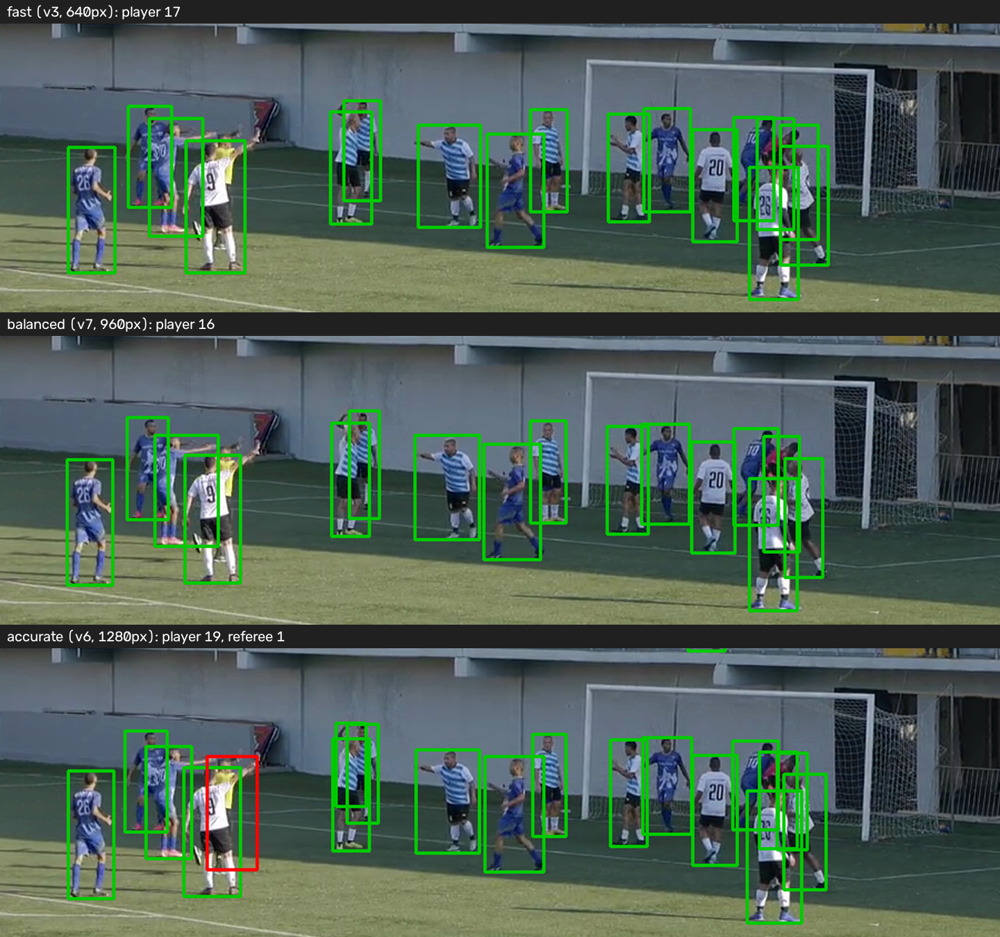
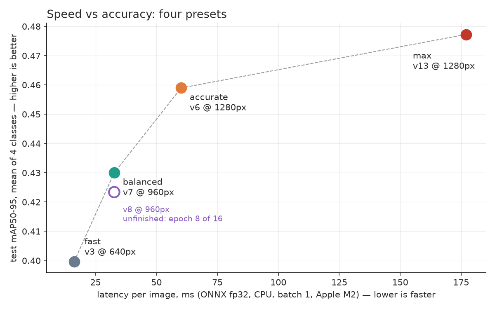
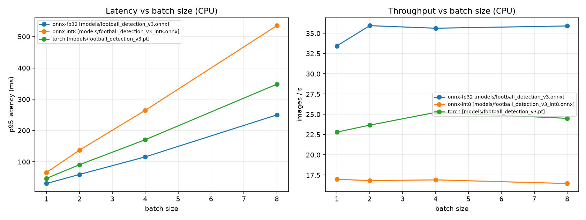
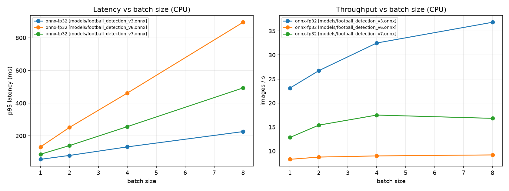
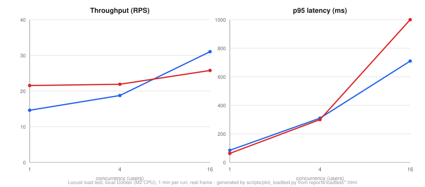

# football-detect-serve

[](https://github.com/Kushagra077/football-detect-serve/actions/workflows/tests.yml)

Football object detection (ball / goalkeeper / player / referee, plus a minor `other`
class) — YOLO26 trained
on broadcast football footage, exported to ONNX, quantized to INT8, and served behind a
batching FastAPI service with a live demo on Hugging Face Spaces.

**[Live demo](https://huggingface.co/spaces/Kushagra77/football-detect-serve)** (Gradio,
ZeroGPU — see the [Live demo](#live-demo) section below for why its numbers won't match
the table below)

The point of the repo is the path from checkpoint to endpoint: every optimization step is
checked against the one before it (ONNX against torch, INT8 against fp32), every backend is measured through the
same code, and the numbers below came from running that code, not from a spec sheet (the few timed by hand are
marked as such).



*One frame from a free-licence amateur match clip (Pexels, not from the training data), cropped, run through the three nano presets (`max` is not shown). The accurate preset (bottom) is the only one that boxes the person in the yellow shirt, presumably the referee (red box). One frame with no ground truth: an illustration, not a metric.*

### 20-second demo

[](demo/brag.mp4)

*Click for the full video with sound ([demo/brag.mp4](demo/brag.mp4)). It's the acceptance sentence below, minus the paragraphs.*

## Results

### Model presets: speed vs accuracy

One service, four trade-off points. A faster model costs accuracy; a more accurate one costs
time. The server loads all four, and `?backend=fast|balanced|accurate|max` picks one per request.



| preset | model | input size | test mAP50-95 | val mAP50-95 | ball AP (test) | latency, batch 1 (p50 / p95) | throughput, batch 8 |
|---|---|---|---|---|---|---|---|
| **fast** | v3 | 640 | 0.400 | 0.469 | 0.111 | 16.2 / 17.1 ms | 66 img/s |
| **balanced** | v7 | 960 | 0.430 | 0.497 | 0.140 | 32.7 / 36.7 ms | 31 img/s |
| **accurate** | v6 | 1280 | 0.459 | 0.529 | 0.178 | 60.1 / 66.4 ms | 16 img/s |
| **max** | v13 (small) | 1280 | 0.477 | 0.550 | 0.199 | 177.1 / 207.3 ms | 5 img/s |

mAP is the 4-class mean (ball / goalkeeper / player / referee) from `scripts/eval_map.py`, the same
evaluator for every model. Latency is ONNX fp32 on CPU (Apple M2, 4 threads, 100 runs after 20 warm-up, real
1080p dataset frames), measured by `scripts/benchmark.py` with each model at its own input size, all four in one
session (`reports/latency.presets.json`). `max` is the val-selected v13 checkpoint; its ONNX file matches torch
exactly on the full val split (`reports/accuracy.onnx.v13.fp32.json`).

- **The first two steps (fast to balanced to accurate) each cost about twice the time and buy about +0.03 test
  mAP; the third (accurate to max) costs about three times as much for +0.018.** The ball gains the most (0.111 to 0.178 across the first three, +60%) but stays
  the weakest class at every size. *max* adds +0.018 test mAP over *accurate* (0.459 to 0.477) and lifts the ball
  from 0.178 to 0.199. Its last checkpoint scores 0.490 on test with the same val score, so the gain over
  *accurate* is +0.018 to +0.031, not one exact number.
- **Same network, different input size, except `max`.** fast, balanced and accurate are YOLO26 nano (a 10 to 11 MB ONNX
  file each): v6 and v7 were trained at 1280 and 960, v3 at 640. *max* is YOLO26 small (v13, 9.95M parameters,
  a 38 MB ONNX file) at 1280.
- **Which to use.** *fast* for real-time video on a CPU (25 fps needs about 25 img/s per stream: fast and
  balanced clear it on this machine, accurate does not). *accurate* for offline analysis, such as reviewing a
  match after it has been played. *max* for a server or a GPU, where the extra cost matters less: on a laptop CPU
  it runs at about 5 to 6 images per second. *balanced* is the default.
- **In Docker** (a Linux VM on the same M2, 8 CPUs, 3.8 GiB; `scripts/measure_docker.py`,
  `reports/docker.presets.json`) one 1080p JPEG upload takes, as the median of 20 `curl` requests after 3
  warm-ups, 60 / 83 / 124 / 303 ms for fast / balanced / accurate / max with the default dynamic batching, and
  42 / 61 / 105 / 275 ms with `?batch=false`. The gap is the batching window: a lone request waits up to
  `MAX_WAIT_MS` (15 ms) for a partner that never comes, plus queue overhead. The whole request includes upload,
  decode and response, and the model itself runs at about 1.5 to 2 times its native speed in the VM (32 / 52 / 94 /
  266 ms server-side with batching off, against 16 / 33 / 60 / 177 ms in the table above). After 184 requests the
  container held all four models in 1.80 GiB of RAM. In a bare process on the same machine one server with all four
  presets loaded held 1.6 GB (timed by hand, not stored under `reports/`).
- **Batch size 2 is slower per image than batch 1 or 4** for all four models (cause not investigated); read
  throughput from batch 4 or 8.
- **v8** repeated v7 with settings from a short hyperparameter search. It was cancelled by a 12-hour session
  limit at epoch 10 of 16, and its best checkpoint (epoch 8) scored 0.423 test / 0.503 val against v7's 0.430 / 0.497, a difference within run-to-run noise (about 0.007), so it
  is reported in the tables but not served.
- **v9 to v13** came after v8; all are in the tables, and only v13 is served (as `max`; test 4-class mean, val in
  the table). **v9** is the v7 recipe with the ball class weighted 2x in the loss (a custom trainer in the Kaggle
  notebook, not in this repo): 0.426, ball 0.151 vs 0.140, no real gain. **v10** repeats v6's recipe at 1280 px as a
  time-capped 25-epoch run that finished (best epoch 15; v6 had planned 30 and stopped at 25; `close_mosaic` 7
  instead of 10): 0.461, the same as v6's epoch-15 checkpoint (0.459), so the unfinished run was not leaving
  accuracy behind. **v11** adds a P2 (stride-4) detection head at 960 px:
  ball AP rises to 0.161 (0.140 for v7) but the 4-class mean stays at 0.426, and it costs 48 ms against 32 ms
  (ONNX fp32, M2 CPU, same session; `reports/latency.other_models.json`). **v12** is the small model (yolo26s) at 960 px: 0.460. **v13** is the small model at 1280 px,
  12 epochs: 0.477, the best so far, with the best ball AP (0.199) and goalkeeper (0.529); `other` fell to 0.276,
  a class with 1,313 test instances that is not in the headline number. Its last checkpoint (epoch 12, the end of
  the shortened schedule) scores higher on test, 0.490 (ball 0.203, goalkeeper 0.558), with the same val score
  (0.549 against 0.550), so val cannot choose between the two; the table shows the val-selected best checkpoint. The small model is about three times slower
  than nano at the same size (v7 32 ms against 98 ms for an untrained small export at 960 px; v6 59 ms against
  180 ms at 1280 px, where v13 itself takes 177 ms; all ONNX fp32 on the M2 CPU in one session,
  `reports/latency.other_models.json`), so v13 is a server-side candidate, not a laptop preset.
  Tiled inference (SAHI-style) was also tried on every 10th val frame with v7: the best tiled setup reached ball
  AP 0.154 against 0.173 for v6 on the whole frame, at about 4 times v7's latency (the setups tried cost 4 to 9
  times; `reports/tiling_experiment.val.json`).

### Accuracy

Two evaluations, because the two splits don't mean the same thing:

- **`test`** — 3 matches that appear **nowhere** in training (different stadiums, teams,
  kits, camera setups). This is the trustworthy generalization number.
- **`val`** — carved out of the training pool (every 5th sequence), which only contains
  3 matches total. So val shares stadiums/kits/cameras with training and reads
  **optimistically**. Kept for training-time monitoring, not as a headline result.

Model lineage: **v1 nano** and **v2 small** are 10-epoch baselines. **v3 nano** is the
640 px nano behind the `fast` preset — 20 epochs, with `mixup=0.1` added specifically to help the rare, tiny ball
class. (`copy_paste` is not used: it requires per-instance segmentation masks, and this is
a bbox-only detection dataset — with no masks it silently no-ops in ultralytics, so it's
left off rather than set and ignored.) v3 replaces v1; v1's numbers are kept as the
before/after reference.

Later runs changed the input size, which turned out to be the biggest lever: **v6** trained at 1280 (30 planned epochs, stopped at epoch 25 by a session limit; the epoch-15 checkpoint, the best on validation, is the one evaluated and served), **v7** at 960 (20 epochs, `scale` 0.5, `mixup` 0, `close_mosaic` 5), and **v8** repeated v7 with tuned settings and is unfinished (see [Model presets](#model-presets-speed-vs-accuracy)). **v9 to v13** (a ball-weighted loss, a finished 1280 run, a P2 head, and the small model at 960 and 1280) are in the tables below; only v13 is served (as the `max` preset).

#### test split — mAP50-95, torch, 36,750 images (the real number)

| model | all\* | ball | goalkeeper | player | referee | other† |
|---|---|---|---|---|---|---|
| v1 nano (10ep baseline) | 0.369 | 0.090 | 0.377 | 0.571 | 0.435 | 0.245 |
| **v3 nano** | 0.400 | **0.111** | 0.435 | 0.594 | 0.459 | 0.225 |
| **v2 small** | 0.431 | 0.131 | 0.484 | 0.618 | 0.492 | 0.231 |
| **v7 nano, 960px** | 0.430 | 0.140 | 0.457 | 0.629 | 0.494 | 0.371 |
| v8 nano, 960px (unfinished, epoch 8 of 16) | 0.423 | 0.141 | 0.438 | 0.624 | 0.491 | 0.258 |
| **v6 nano, 1280px** | 0.459 | 0.178 | 0.506 | 0.645 | 0.507 | 0.378 |
| v9 nano, 960px, ball-weighted loss | 0.426 | 0.151 | 0.435 | 0.628 | 0.488 | 0.362 |
| v10 nano, 1280px (v6 recipe, 25 epochs, finished) | 0.461 | 0.183 | 0.506 | 0.646 | 0.510 | 0.397 |
| v11 nano + P2 head, 960px | 0.426 | 0.161 | 0.422 | 0.630 | 0.490 | 0.386 |
| v12 small, 960px | 0.460 | 0.188 | 0.483 | 0.650 | 0.521 | 0.421 |
| v13 small, 1280px (best so far, the `max` preset) | 0.477 | 0.199 | 0.529 | 0.660 | 0.521 | 0.276 |

\* 4-class mean (ball/goalkeeper/player/referee) — the headline number. † `other` is a
minor class, not included in `all`: it's SoccerNet-derived catch-all (sideline staff,
etc.), thinly validated (0 instances in val, 1,313 in test), and over-predicted. Its test AP
is 0.23-0.25 for v1/v2/v3 and between 0.26 and 0.42 for the later runs (v8 at 0.258 is the lowest of
those, then v13 at 0.276); it swings from run to run, so it is kept in the model for completeness, not as a class the
headline number should ride on.

**v1 → v3**: ball AP **+22%** on this trustworthy split (0.090 → 0.111), every other real
class up too — the extra epochs and `mixup` combined to help. (Two things changed at once —
10→20 epochs *and* `mixup` — so the gain can't be cleanly attributed to either alone.)

#### val split — mAP50-95, 8,250 images (training-time monitoring only)

| model | backend | all\* | ball | goalkeeper | player | referee |
|---|---|---|---|---|---|---|
| off-the-shelf COCO yolo26n (remapped) | torch | 0.093 | 0.013 | 0.000 | 0.361 | 0.000 |
| v1 nano (10ep baseline) | torch | 0.427 | 0.069 | 0.475 | 0.603 | 0.560 |
| **v3 nano** | torch | 0.469 | 0.094 | 0.564 | 0.629 | 0.591 |
| **v3 nano** | onnx-fp32 | 0.469 | 0.094 | 0.564 | 0.629 | 0.591 |
| **v3 nano** | onnx-int8 | 0.436 (−0.033) | 0.080 | 0.527 | 0.587 | 0.552 |
| **v2 small** | torch | 0.487 | 0.129 | 0.575 | 0.639 | 0.605 |
| v2 small | onnx-fp32 | 0.487 | 0.129 | 0.575 | 0.639 | 0.605 |
| v2 small | onnx-int8 | 0.423 (−0.064) | 0.069 | 0.497 | 0.577 | 0.549 |
| **v7 nano, 960px** | torch | 0.497 | 0.146 | 0.573 | 0.652 | 0.615 |
| v8 nano, 960px (unfinished) | torch | 0.503 | 0.139 | 0.605 | 0.654 | 0.615 |
| **v6 nano, 1280px** | torch | 0.529 | 0.185 | 0.642 | 0.662 | 0.625 |
| v9 nano, 960px, ball-weighted loss | torch | 0.506 | 0.145 | 0.601 | 0.656 | 0.620 |
| v10 nano, 1280px (v6 recipe, 25 epochs, finished) | torch | 0.530 | 0.195 | 0.636 | 0.662 | 0.628 |
| v11 nano + P2 head, 960px | torch | 0.515 | 0.177 | 0.610 | 0.654 | 0.618 |
| v12 small, 960px | torch | 0.542 | 0.204 | 0.659 | 0.672 | 0.632 |
| v13 small, 1280px (best so far, the `max` preset) | torch | 0.550 | 0.219 | 0.664 | 0.674 | 0.643 |
| **v7 nano, 960px** | onnx-fp32 | 0.497 | 0.146 | 0.573 | 0.652 | 0.615 |
| **v6 nano, 1280px** | onnx-fp32 | 0.529 | 0.185 | 0.642 | 0.662 | 0.625 |
| **v6 nano, 1280px** | onnx-int8 | 0.483 (−0.046) | 0.135 | 0.577 | 0.623 | 0.598 |

\* 4-class mean — `other` has 0 instances in val, so it's excluded. ONNX/INT8 rows are
val-only: they measure export fidelity and quantization cost, not generalization. The v7 and v6 fp32 ONNX
files match torch to three decimals in every class (the export gate). Of the higher-resolution presets only v6 was INT8-quantized: it costs
−0.046, more than v3's −0.033, and INT8 gave no speed gain on this CPU (timed on v3 only, see Latency), so the presets ship fp32.

#### val vs test: the gap is leakage, and its shape confirms it

Like-for-like (4-class mean, `other` excluded): v3 drops 0.469 → 0.400 (**−15%**),
v1 0.427 → 0.369 (−14%), v2 0.487 → 0.431 (−11%). The drop is concentrated in
**goalkeeper and referee** (−0.09 to −0.13 each) while **player barely moves**
(−0.02 to −0.04). That's the signature of match-level leakage, not random variance:
players look the same in any match, but a keeper's kit and a ref's uniform are
match-specific — memorizing them from training only helps on a val split that reuses
those matches. `ball` is dominated by noise at this training length.

- ONNX-fp32 reproduces torch to <0.001 mAP per class (val), across v1/v2/v3 — the export
  path is faithful.
- INT8 costs 0.03-0.06 mAP50-95 (val) — v1 −0.027, v2 −0.064, v3 −0.033. On v1 the ball
  class took the biggest relative hit (~41%); on v3 it's only ~15%, so the v3 ball
  detector (extra epochs + `mixup`) survives quantization noticeably better.
- v1/v2 are **10-epoch**, v3 is **20-epoch**: short runs. The later runs show validation accuracy flattening after
  about 15 epochs (see Limitations), but every number here is still one run and moves with a new training run.
- **Evaluator cross-check** (`scripts/crosscheck_map.py`, v3 only; reports in `reports/crosscheck.v3.*.json`):
  ultralytics' own `YOLO.val()` scores v3 lower than `eval_map.py` on the same split and thresholds, by 0.019
  mAP50-95 on val (0.451 against 0.469) and 0.015 on test (0.349 against 0.365; both means include `other`
  on test). For ball, goalkeeper, player and referee `eval_map.py` is higher on both splits, by 0.006 to 0.035 per
  class (referee on test, 0.035, is the one gap above the script's 0.03 flag threshold); `other` (test only) goes the
  other way by 0.005. Letterboxing is not the cause: running `YOLO.val()` with `rect=False` changes the val mean
  by less than 0.0001 (gap 0.0186 against 0.0185), so the source of the offset is not isolated. So the tables above may read
  about 0.015-0.02 high against ultralytics' own number; the offset is similar across classes and both splits, so
  comparisons between models should hold, but it was measured on v3 only.

### Latency (single-request, CPU, Apple M2 8-core, batch=1, v3 nano)

| backend | p50 ms | p95 ms | p99 ms | img/s |
|---|---|---|---|---|
| torch | 24.9 | 27.3 | 33.7 | 39.3 |
| onnx-fp32 | 16.3 | 18.7 | 20.2 | 60.1 |
| onnx-int8 | 19.0 | 21.0 | 23.0 | 51.9 |

(Latency tracks the architecture, not the checkpoint: v1 and v3 are both yolo26n.)

**onnx-fp32 is 1.5x torch, free** — no accuracy cost (see table above), just a different
runtime. **onnx-int8 is *slower* than fp32 on this hardware** (1.17x). My first guess was that Apple
Silicon (ARM) lacks the x86-VNNI instructions onnxruntime's INT8 kernels are tuned for; the x86 run below
shows that guess was wrong. FP16 was measured and dropped from this table: on CPU it ties
fp32 on accuracy and is *slower* (onnxruntime has no native fp16 kernels on CPU, so it
upcasts and pays the cast cost) — FP16 only helps on GPU, and this service targets CPU.

### Latency (single-request, CPU, x86_64, 2 physical cores, batch=1, v3 nano)

Measured on GitHub Actions' `ubuntu-latest` runner, confirming or denying the ARM-kernel-tuning
hypothesis above instead of leaving it hedged (`reports/latency.x86.json`). This came from an earlier version of
`.github/workflows/benchmark.yml` that timed v3's torch, fp32 and int8 files; the current workflow times the four
presets in fp32 only (next table), so it cannot reproduce this one:



| backend | p50 ms | p95 ms | p99 ms | img/s |
|---|---|---|---|---|
| torch | 43.7 | 47.2 | 47.9 | 22.8 |
| onnx-fp32 | 29.8 | 30.8 | 31.3 | 33.4 |
| onnx-int8 | 57.7 | 66.0 | 69.4 | 17.0 |

**The hypothesis was wrong.** onnx-int8 is *slower* than fp32 on x86 too (1.9x, worse
than the 1.2x gap on ARM) — not an ARM-specific kernel-tuning artifact, a property of
this model/runtime pairing on CPU generally. The 2-physical-core runner also makes every
backend slower in absolute terms than the 8-core M2, so absolute numbers aren't
comparable across the two tables — only the fp32-vs-int8 *ordering* is the point of
this run, and it agrees with the M2 result.

### Latency of the four presets (CPU, x86_64, 2 physical cores, onnx-fp32, batch=1)

The same four files the API serves, benchmarked in CI (`benchmark.yml`, GitHub's `ubuntu-latest`
runner, each at its own input size; `reports/latency.x86.presets.json`):



| preset | model | input | p50 ms | p95 ms | p99 ms | img/s |
|---|---|---|---|---|---|---|
| fast | v3 | 640 | 11.9 | 12.2 | 15.5 | 83.5 |
| balanced | v7 | 960 | 23.6 | 24.7 | 46.8 | 41.3 |
| accurate | v6 | 1280 | 39.4 | 42.3 | 57.1 | 24.8 |
| max | v13 (small) | 1280 | 126.2 | 128.9 | 132.5 | 7.9 |

The frames are synthetic 1920x1080 noise (the CI runner has no dataset; `benchmark.py` records the frame source in
its report). The ranking holds on a different CPU.

- **Ratios.** Relative to fast at the median: balanced 2.0x, accurate 3.3x, max 10.6x (on the M2: 2.0x, 3.7x,
  10.9x). Max costs 3.2x of accurate for the same input size: the small model, not the resolution, is what makes
  it slow. Fast, balanced and accurate have p99s well above their p50s (15.5, 46.8, 57.1 ms), a few slow runs on
  the shared runner, so ratios of p99s mostly measure that noise.
- **Batching does not help here.** Throughput is flat or falling with batch size: fast 83.5 img/s at batch 1 and
  83.9 at batch 8, balanced 41.3 to 35.9, accurate 24.8 to 19.3. Max drops from 7.9 to 4.5 img/s at batch 8, and
  that run is erratic (min 1172 ms, p50 1985 ms, std 380 ms for the batch), so read it as "no gain, possibly a
  loss", not as a measured 43% penalty. The previous CI run of this table (older runner image) showed batching
  helping by up to +59%, so the batching effect is runner-dependent; it is one run each.
- **Do not compare absolute numbers across CI runs.** v3 onnx-fp32 measured 29.8 ms in the earlier v3-only run
  (onnxruntime 1.29, a different kernel version), 49.6 ms in the first presets run (square frames), 35.5 ms in the
  second (16:9 frames) and 11.9 ms in this one. All four used the `ubuntu-latest` label, and the three presets runs
  report the same platform string and onnxruntime 1.31.1 yet differ by up to 4x. The report does not record the CPU model,
  so I can't say whether the runner pool handed out faster hardware; only ratios *within* one run mean anything. The runs also cover different things: the earlier v3-only
  one compares torch / fp32 / int8, this one compares the four presets in fp32 only.

**Why the frame shape matters.** A model letterboxes its input to its own size: a square frame is padded to the
full square (960x960 for balanced, 1280x1280 for accurate) while a real 16:9 frame is padded to 960x544 and
1280x736, about 1.7x fewer pixels. The first presets run used a 640x640 *square* of noise for every model. On the
M2 (timed by hand, not stored in `reports/`) the same noise costs 25.6 / 59.2 / 107 ms as a 640x640 square and 16.1 / 31.9 / 59.4 ms as a 1920x1080 frame
(fast / balanced / accurate), so the square overstated latency by 1.6x to 1.9x there. On CI the fix lowered the
medians of the second run by 24% to 34% (49.6 to 35.5, 110 to 84, 194 to 129 ms), a smaller drop than on the M2; runner variation
is mixed into that, so one CI run cannot separate the two effects. The Apple M2 table above was timed on real
dataset frames.

### Load test: does batching help? (Locust, local Docker, v3 `onnx-fp32` = the `fast` preset, 1 min/run)



| concurrency | batching | RPS | p50 ms | p95 ms | p99 ms |
|---|---|---|---|---|---|
| 1 | on | 14.6 | 65 | 85 | 100 |
| 1 | off | 21.5 | 43 | 63 | 89 |
| 4 | on | 18.7 | 240 | 310 | 330 |
| 4 | off | 21.9 | 170 | 300 | 470 |
| 16 | on | 31.0 | 490 | 710 | 1000 |
| 16 | off | 25.8 | 610 | 1000 | 1100 |

These six runs were made on 2026-11-09 with the commands in [Load test](#load-test) against the current Docker
image (four presets loaded; `FDS_BACKEND=fast` sends every request to v3). An earlier set from 2026-09-06 on a
v3-only image gave the same overall picture (batching loses at concurrency 1 and wins at 16): throughput and
median were within about 22% of these, while tail percentiles moved by up to 44% and the concurrency-4 p99 ordering
flipped (git history has those reports).

A real bug these runs exposed, now fixed: `?batch=false` requests were
calling `backend.predict()` straight from the executor thread pool with no synchronization,
so concurrent nobatch requests could run on the same underlying model object at once —
ultralytics' `YOLO` isn't thread-safe, so that's silent data-corrupting territory, not just
a performance question. Fixed with a `predict_lock` per backend
(`app/backends/base.py`), held by both the nobatch path and the batch worker. The cost shows in the
concurrency-16 nobatch tail: its slowest response took 9.5 s (1.4 s with batching), because requests now
genuinely queue for the lock instead of unsafely overlapping.

**The answer is still "it depends on load," not a flat yes/no.** At concurrency 1, batching is pure overhead:
a request rarely finds a batch partner inside the 15 ms `MAX_WAIT_MS` window, so it pays that wait and then runs
solo anyway (nobatch is faster at every percentile). At concurrency 4 the picture is the same for throughput and
median (18.7 against 21.9 RPS, 240 against 170 ms) with p95 about equal (310 against 300 ms); batching shows the
better p99 here (330 against 470 ms), a single-run difference I would not read as a win. At concurrency 16,
batching wins outright: higher throughput (31.0 against 25.8 RPS) *and* lower latency at every percentile, because
enough concurrent requests land inside the window to be grouped into one forward pass, which beats 16 single-image
calls serializing behind the same lock. Zero request failures across all six runs.

### The acceptance sentence

> The ONNX runtime gave **1.5x** for free; INT8 bought **nothing** on CPU — ARM or x86 —
> and cost 0.03-0.06 mAP50-95 — the honest result of measuring rather than assuming.

## Design rules

1. **One inference path per backend, no custom decode.** `app/backends/torch_backend.py`
   and `onnx_backend.py` both call ultralytics' own `YOLO(...).predict()`, which knows how
   to decode YOLO26's end-to-end (NMS-free, top-k) head — a hand-rolled decoder assuming
   the classic dense anchor-grid output silently produced garbage on this architecture
   (the old decoder was removed). `app/backends/base.py` holds the shared
   `Detection`/`to_detections()` contract both backends convert ultralytics' output through, the `DetectorBackend`
   interface (with its `predict_lock`), `resolve_imgsz` and the `build_backend` factory — no manual
   letterbox/decode step exists in this repo.
2. **One evaluator for every backend.** `scripts/eval_map.py` computes COCO-style AP
   itself for torch and ONNX alike through the shared `DetectorBackend.predict()`
   interface, so comparing backends never means comparing two different measurement
   methods. It's cross-checked against ultralytics' own `YOLO.val()` via
   `scripts/crosscheck_map.py` — their means differ by 0.015-0.02 mAP50-95 (see Accuracy).
3. **Parity via the same evaluator, not a separate raw-tensor diff.** ONNX-vs-torch
   fidelity is checked by running `eval_map.py` on both and comparing per-class mAP to
   3 decimal places, not by diffing raw model output tensors (which YOLO26's end-to-end
   head format makes brittle across backends).
4. **Quantize against real data - deliberately sampled, not just sliced.** `--quantize 8`
   calibrates INT8 on 345 real training images run through the real preprocessing path,
   picked by `scripts/build_calibration_set.py` to spread evenly across all 46 training
   sequences. That script exists because the naive version (`--split train --fraction
   0.01`) doesn't randomly sample anything: ultralytics sorts the file list alphabetically
   before slicing a fraction, and with `<sequence>_<frame>.jpg` filenames that's the first
   ~345 frames of whichever sequence sorts first - one ~14-second clip, one stadium, one
   lighting condition. Either way the result is a measured mAP drop, not an assumption -
   but only the stratified sample is a calibration set that means anything.

## Layout

```
configs/train.yaml           epochs, imgsz, batch, augmentation, expected class map
scripts/prepare_data.py      verify class map, count instances, flag bad labels
scripts/convert_mot_to_yolo.py   MOT gt.txt + gameinfo.ini -> YOLO format
scripts/train.py              thin wrapper over ultralytics
scripts/build_calibration_set.py  shuffled, cross-sequence image list for INT8 calibration
scripts/export_onnx.py        pt -> onnx, fp32/fp16/int8, static INT8 calibration
scripts/eval_map.py           per-class mAP for ANY backend, one code path
scripts/crosscheck_map.py     eval_map.py vs ultralytics YOLO.val() - evaluator sanity check
scripts/benchmark.py          single-request latency harness -> reports/latency.json (each model at its own size)
scripts/plot_presets.py       speed/accuracy, per-class and training-curve charts, from the report files
scripts/render_presets.py     one frame through the three nano presets, stacked (fast / balanced / accurate)
scripts/measure_docker.py      Docker image: per-preset request time, RAM, image size -> reports/docker.presets.json
scripts/extract_curves.py     validation mAP per epoch out of checkpoints -> reports/training_curves.json
scripts/tile_eval.py          the tiled (SAHI-style) inference experiment -> reports/tiling_experiment.val.json
scripts/plot_loadtest.py      reports/loadtest/*.html -> figures/loadtest.svg
scripts/_paths.py             shared display_path() helper for the scripts' log lines
app/main.py                   FastAPI: /predict /healthz /metrics, multi-backend registry
app/batching.py                asyncio queue + max-wait window
app/metrics.py                 Prometheus metrics (fds_*), labeled by the registry name
app/schemas.py                 request / response models
app/backends/                  base (contract) + torch + onnx (fp32/fp16/int8)
app/gradio_app.py              Detect tab of the HF Space - calls build_backend() directly, no FastAPI
bench/locustfile.py            load test: concurrency x batching on/off
Dockerfile, .dockerignore      the local serving image (four presets baked in)
requirements.txt, pyproject.toml   install lists (Docker/CI vs local dev; they differ on purpose)
models/                        the four preset ONNX files + sidecars, v3 .pt / int8, download_weights.py
reports/                       every number quoted in this README (see Reports)
demo/                          the 20-second demo video
.github/workflows/             tests.yml (pytest) and benchmark.yml (x86 latency, manual or on model changes)
tests/                         pytest suite (fake backend, no weights; see Testing)
notebooks/                     dataset download, MOT -> YOLO conversion check, and a 1-epoch local smoke-test training run
                               (the real v1-v13 runs were Kaggle notebooks that are not in the repo)
```

## Setup

```bash
python -m venv .venv && source .venv/bin/activate
pip install -r requirements.txt
```

The weights the four serving presets load (`models/football_detection_v3.onnx`, `_v7.onnx`, `_v6.onnx`, `_v13.onnx`, with a `.meta.json` beside each that records its input size) are included, so `docker build` and CI work from a clean clone. They are for non-commercial research use only (see [License](#license)). To reproduce them, run [Pipeline](#pipeline) below on your own [SoccerNet](https://www.soccer-net.org/data) access: the data, frames and labels are not distributed here, and `models/download_weights.py` has no default source to fetch from. The [Live demo](#live-demo) has the models loaded if you only want to see it work.

**Dataset license.** SoccerNet's annotations are released under **CC BY-NC 4.0**
(non-commercial). The broadcast videos themselves are separately gated behind an NDA —
downloading them requires submitting SoccerNet's NDA form, and redistributing the raw
video is prohibited by that agreement. Neither the videos nor the derived frames/labels
are distributed in this repo (the dataset dirs are gitignored) — you must obtain
your own SoccerNet access to reproduce the pipeline. See the
[SoccerNet FAQ](https://www.soccer-net.org/faq) for the full terms.

## Testing

```bash
pytest -v
```

`tests/` covers the pure logic — batching, metric math, label validation, the API's
error paths — through a fake `DetectorBackend` (`tests/conftest.py`). No test loads model
weights, imports ML deps (torch/ultralytics/onnxruntime) or reads dataset images, so the suite runs in about
a second and needs nothing beyond what's already installed for serving. A few tests only check that tracked
files agree with each other: the four presets are declared consistently (`test_presets.py`) and every number in
the README tables matches its report (`test_readme_numbers.py`). Runs automatically on every push to `main` and on
every pull request via GitHub Actions (`.github/workflows/tests.yml`) — that's the badge at the top of this file.

## Pipeline

```bash
# 1. dataset: convert MOT tracking labels to YOLO format, then verify + count instances
python scripts/convert_mot_to_yolo.py --src <path-to-raw-mot-data>
python scripts/prepare_data.py --skip-download --out dataset

# 2. train (hyperparameters in configs/train.yaml)
# NOTE: the actual v1 to v13 checkpoints were trained via a raw model.train(...)
# call in a Kaggle notebook (multi-GPU), not through this script - configs/train.yaml
# documents the current (v3) recipe for reference, but editing it does not affect a
# Kaggle run. scripts/train.py + this command is the from-scratch reproduction path.
# configs/train.yaml holds the v3 recipe (20 epochs) and a table of how v7, v6 and v13 differed.
python scripts/train.py --weights yolo26n.pt --out models/football_detection_v3.pt --set epochs=20

# 3. accuracy (one code path for every backend). --split test is the trustworthy number,
#    --split val (default) is training-time monitoring only - see Results.
python scripts/eval_map.py --backend torch --weights models/football_detection_v3.pt --split test
# optional: sanity-check eval_map.py against ultralytics' own evaluator (means differ by about 0.015-0.02 mAP)
python scripts/crosscheck_map.py --weights models/football_detection_v3.pt --split test --device mps

# 4. export: fp32, fp16, int8. int8 calibrates on a curated, shuffled,
#    cross-sequence sample - NOT `--split train --fraction 0.01` directly,
#    which slices ultralytics' alphabetically-sorted file list and ends up as
#    the first ~345 frames of one clip (see build_calibration_set.py).
#    Run --quantize none LAST: ultralytics writes every export to <name>.onnx first and the script then renames
#    it to _fp16 / _int8, so a quantized export overwrites an existing fp32 file.
python scripts/build_calibration_set.py
python scripts/export_onnx.py --weights models/football_detection_v3.pt --quantize 16
python scripts/export_onnx.py --weights models/football_detection_v3.pt --quantize 8 \
    --data dataset/calib_data.yaml --split train --fraction 1.0
python scripts/export_onnx.py --weights models/football_detection_v3.pt --quantize none

# 5. CHECK — onnx-fp32 should match torch to ~0.001 mAP per class; read the int8 drop and judge it.
#    --compare-to prints the drop against a baseline report; no pass/fail threshold is set (add --max-map-drop <x>
#    to gate on one, see configs/train.yaml's quantize: block for why none is published).
python scripts/eval_map.py --backend onnx --weights models/football_detection_v3.onnx \
    --compare-to reports/accuracy.torch.v3.json
python scripts/eval_map.py --backend onnx --weights models/football_detection_v3_int8.onnx \
    --compare-to reports/accuracy.onnx.v3.fp32.json

# 6. single-request latency across backends and batch sizes
python scripts/benchmark.py
```

## Serving

```bash
MODELS="fast=models/football_detection_v3.onnx,balanced=models/football_detection_v7.onnx,accurate=models/football_detection_v6.onnx,max=models/football_detection_v13.onnx" \
DEFAULT_BACKEND=balanced uvicorn app.main:app --host 0.0.0.0 --port 7860
```

One process serves several models at once — `?backend=` picks one per request, so you can
demo and load-test the presets (or torch / onnx-fp32 / onnx-int8 of one model) side by side
without redeploying. **Each model runs at its own input size**: read from the `.meta.json` next to
the model, or set with a suffix (`MODELS="x=models/m.onnx@960"`). The backend type follows the file
(`.pt` is torch, anything else onnx), so names are free. `/healthz` lists the size of every loaded model.

| Env var | Default | Notes |
| --- | --- | --- |
| `MODELS` | `fast` (v3) + `balanced` (v7) + `accurate` (v6) + `max` (v13), ONNX fp32 | `name=path[@imgsz],name=path,...` |
| `DEFAULT_BACKEND` | first entry in `MODELS` (the Docker image sets `balanced`) | used when `?backend=` is omitted |
| `DEVICE` | `cpu` | |
| `IMGSZ` | `640` | fallback only, for a model with no `@size`, no sidecar and (for a `.pt`) no size saved in the checkpoint |
| `CONF` / `IOU` / `MAX_DET` | `0.25` / `0.45` / `300` | postprocess defaults, overridable per request |
| `MAX_BATCH_SIZE` | `8` | dynamic batch cap |
| `MAX_WAIT_MS` | `15` | how long a request waits to be batched |
| `MAX_QUEUE_SIZE` | `256` | overflow returns 503 rather than queueing forever |
| `WARMUP_RUNS` | `3` | dummy predictions per model at start-up |
| `MAX_UPLOAD_BYTES` | `10485760` (10 MiB) | upload cap; the base64 JSON body gets a cap 4/3 larger |
| `LOG_LEVEL` / `HOST` / `PORT` | `INFO` / `0.0.0.0` / `7860` | `HOST` and `PORT` only apply when started with `python -m app.main` (the Docker image uses `PORT`) |

### Endpoints

```bash
# multipart upload, pick a backend, bypass batching
curl -sS -F file=@frame.jpg "localhost:7860/predict?backend=accurate&batch=false" | jq

# json (base64 or url), with per-request thresholds
curl -sS localhost:7860/predict -H 'content-type: application/json' \
  -d '{"image_b64":"<...>","options":{"conf":0.4}}' | jq

curl -sS localhost:7860/healthz | jq   # lists every loaded backend and its input size
curl -sS localhost:7860/metrics | grep fds_   # per-backend counters/histograms
```

`/predict` returns boxes in original image coordinates plus `inference_ms`, `total_ms`,
`batch_size` and `batched` — the gap between `inference_ms` and `total_ms` is decode plus
(if `batched=true`) queue wait, plus any `image_url` download. When batched, `inference_ms` is the whole forward
pass of the group, not a per-image time; with `?batch=false` it also includes the wait for the backend's lock.

### Batching

One worker task per backend drains an asyncio queue and fires a forward pass as soon as
either `MAX_BATCH_SIZE` requests are ready or `MAX_WAIT_MS` has passed since the first one
arrived. Requests that carry different `conf` / `iou` / `max_det` overrides cannot share a forward pass, so a
collected batch is split into one pass per distinct setting. `?batch=false` skips the queue entirely for a direct
comparison. State is
per-process, so run `--workers 1` and scale with replicas, not worker count.

## Docker

**Local-only.** HF Docker Spaces are a paid tier, so this image is never deployed — it
exists to run the multi-backend service under the Locust load test and produce the
latency/throughput numbers above. The public demo is the separate [Gradio
app](#live-demo) instead.

```bash
docker build -t football-detect-serve:local .
docker run --rm -p 7860:7860 football-detect-serve:local
```

The image serves the four presets (fast / balanced / accurate / max) by default. Both backends
decode through ultralytics (see Design rules), so it includes torch + ultralytics, not just
onnxruntime: 2.79 GB on disk. With all four presets loaded the container used 1.80 GiB of RAM after 184 requests,
inside the 3.8 GiB Docker Desktop VM it was measured in (`reports/docker.presets.json`).

## Load test

```bash
# FDS_BACKEND=fast pins v3 (the model the saved reports measured); without it the server's default (balanced) is used.
# Locust sends one real frame: by default the first image under dataset/images/test/ (not distributed, see Setup),
# so on a clean clone also set FDS_IMAGE=path/to/frame.jpg.
FDS_BACKEND=fast locust -f bench/locustfile.py --headless -u 16 -r 16 -t 1m \
    --host http://localhost:7860 --html reports/loadtest/c16_batch.html

FDS_BACKEND=fast FDS_BATCH=false locust -f bench/locustfile.py --headless -u 16 -r 16 -t 1m \
    --host http://localhost:7860 --html reports/loadtest/c16_nobatch.html
```

Or drop `--headless` for the interactive web UI at `localhost:8089`. `FDS_IMAGE` /
`FDS_BACKEND` / `FDS_BATCH` env vars control the request; see `bench/locustfile.py` for
details. Six HTML reports (concurrency 1/4/16 x batching on/off, v3 only) are in
`reports/loadtest/`.

## Live demo

The Detect tab of the [HF Space](https://huggingface.co/spaces/Kushagra77/football-detect-serve) is a
Gradio app (`app/gradio_app.py`) that calls `build_backend()` directly — no FastAPI, no
batching queue, since it's a low-traffic demo, not the thing under load test. The Space's own entry point is a
two-tab hub: besides this detector it hosts a separate video-tracking tab from the
[football-team-tracker](https://github.com/Kushagra77/football-team-tracker) repo, which is not part of this
repository (tracking stays out of scope here).

HF's free tier only offers **ZeroGPU** hardware (not standalone CPU), so every backend in
the demo runs through one `@spaces.GPU`-wrapped call and *may* execute GPU-accelerated —
including the ONNX backends, since ZeroGPU makes `torch.cuda.is_available()` report `True`
everywhere in the process and ultralytics' ONNX backend touches raw CUDA internals
regardless of which execution provider you asked for. **This means the demo's relative
backend speed will not match the CPU latency table above** — that table is the real
comparison; the Space is for checking correctness and accuracy, not speed.

## Reports

| File | Written by |
| --- | --- |
| `reports/dataset.json` | `prepare_data.py` — per-class instance counts, label problems |
| `reports/accuracy.<backend>.<model>.json`, `accuracy.torch.v<N>[.test].json` | `eval_map.py` writes `accuracy.<backend>.<weights stem>.json` (no split in the name, so a `--split test` run overwrites a val one); the committed `v<N>` / `.test` names are those files renamed by hand. `v13_last` is the last-epoch checkpoint of v13 (the 0.490 / 0.549 figures) |
| `reports/latency.json`, `figures/latency.png` | `benchmark.py` (local, Apple M2) |
| `reports/latency.x86.json`, `figures/latency.x86.png` | `benchmark.py` on v3's torch / fp32 / int8 files, from an earlier `benchmark.yml` CI run (x86); the workflow now times the four presets, see the next rows |
| `reports/latency.presets.json` | `benchmark.py` on the v3 / v7 / v6 / v13 ONNX presets (Apple M2) |
| `reports/docker.presets.json` | `measure_docker.py` (the four presets inside the Docker image: request time, RAM, image size) |
| `reports/latency.other_models.json` | `benchmark.py` batch 1 on v7, v11 (P2 head), v6, v13 and untrained yolo26s exports at 960 / 1280 (Apple M2, one session) |
| `reports/latency.x86.presets.json`, `figures/latency.x86.presets.png` | `benchmark.py` on the same presets (the `benchmark.yml` artifact, saved under this name; x86) |
| `reports/tiling_experiment.val.json` | `tile_eval.py` — the tiled-inference experiment on every 10th val frame |
| `reports/crosscheck.v3.val.json`, `.val.rect_false.json`, `.test.json` | `crosscheck_map.py --report` (eval_map.py vs `YOLO.val()`, v3) |
| `reports/training_curves.json` | validation mAP per epoch, copied out of the checkpoints by `extract_curves.py` |
| `figures/presets_*.png` (except `presets_example.png`), `figures/training_curves.png` | `plot_presets.py` |
| `figures/presets_example.png` | `render_presets.py` |
| `reports/loadtest/*.html`, `figures/loadtest.svg` | Locust (six runs, v3); `plot_loadtest.py` draws the chart from them |

## Limitations

- **Short training runs.** v1/v2 are 10-epoch, v3 and v7
  are 20-epoch, v6 stopped at 25 of 30, v8 at 10 of 16. v10 to v13 were capped by time (ultralytics' `time=`
  overrides `epochs`), so they ran 12 to 42 epochs. In the runs that went far enough, validation
  accuracy stopped improving after about 15 epochs (v10 and v11 peaked at epoch 15, v12 at 12, v13 at 7; see
  `figures/training_curves.png`), so more epochs alone are unlikely to move the numbers much.
- **Single runs, no error bars.** Every number is one training run and one evaluation. Differences
  of about 0.01 mAP (for example v7 vs v8) should not be trusted.
- **`val` overlaps with training at the match level.** The training pool contains only
  3 matches; `val` is carved from it by holding out every 5th sequence, so held-out clips
  share a stadium/kit/camera with training clips from the same game. The `test` split
  (3 entirely separate matches) doesn't have this problem — it's the number to trust, and
  the [Accuracy](#accuracy) section reports both so the ~11-15% gap is visible rather than
  hidden. A cleaner fix (hold out a whole match for val) isn't really available with only
  3 training matches — this is a dataset-size constraint, not just a split bug.
- **The `other` class is thinly validated.** It has 0 instances in `val` (AP undefined
  there) and only 1,313 in `test` — where it scores 0.23-0.25 for v1/v2/v3 and 0.26-0.42 for
  later runs, and every model over-predicts it. Kept in the model and reported for completeness, but excluded from
  the headline `all` mean (see [Accuracy](#accuracy)) rather than treated as a class
  worth optimizing for yet — folding it into `player` is a possible later simplification.
- **One degenerate box in the raw source labels**, not introduced by conversion: one
  sequence's `gt.txt` has a `w=0` row. Left as-is rather than patched around.
- **The x86 latency run is CI hardware, not the serving target.** `benchmark.yml` runs
  `scripts/benchmark.py` on a GitHub Actions `ubuntu-latest` runner (2 physical cores) to
  confirm the ARM (M2) INT8-is-slower result isn't a kernel-tuning artifact — it isn't
  (see [Latency](#latency-single-request-cpu-x86_64-2-physical-cores-batch1-v3-nano)) —
  but that runner is shared, variable-load infra, not the Docker image's actual deploy
  target, so absolute x86 numbers should be read as a sanity check, not a latency SLA.
- **The ball is still the weak class at every size** (test AP 0.11 at 640, 0.14 at 960, 0.18 at 1280, 0.20 for the small model at 1280)
  and is heavily over-predicted. Input size is now a choice you make with the presets, not a fixed
  setting. Tiled inference was tried and did not help enough (see the v9 to v13 notes above); ball-specific training beyond a 2x
  loss weight (v9) is untried.
- **Out of scope for this phase:** tracking, video input, team assignment, TensorRT, a
  fancier frontend than the Gradio demo.

## License

[MIT](LICENSE) — covers the code in this repository only. No training data are
distributed here; see the repo's `.gitignore` and the Setup section above.

**Model weights.** The weights in `models/` were trained on SoccerNet data: the annotations are
CC BY-NC 4.0, and the videos are available only under an NDA that limits use to non-commercial
research and forbids redistribution. The weights are shared for **non-commercial research and
demonstration use only** and are not covered by the MIT license. The images in this README come from
free-licence footage, not from the dataset.

`ultralytics` is a hard runtime dependency, not an optional one — training, export,
and both serving backends all go through it (see [Design rules](#design-rules)). It is
licensed **AGPL-3.0**, which is separate from and unaffected by this repository's MIT
license: this repo's own code stays MIT, but using or distributing `ultralytics` itself
is governed by its own AGPL-3.0 terms (including its copyleft and network-use
obligations), independent of how this repo is licensed.
